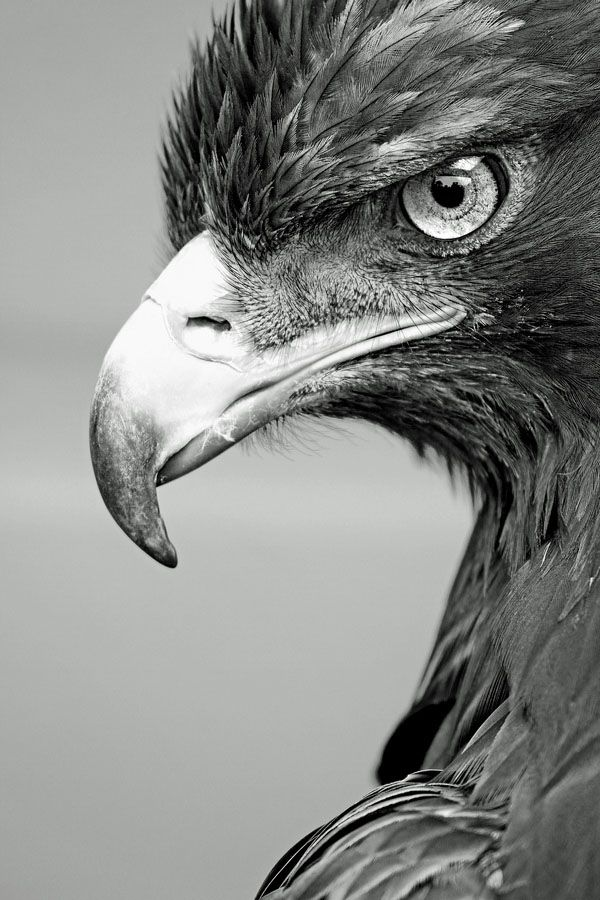
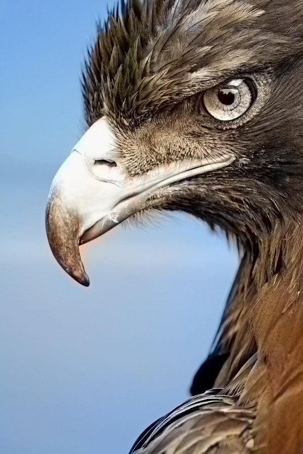
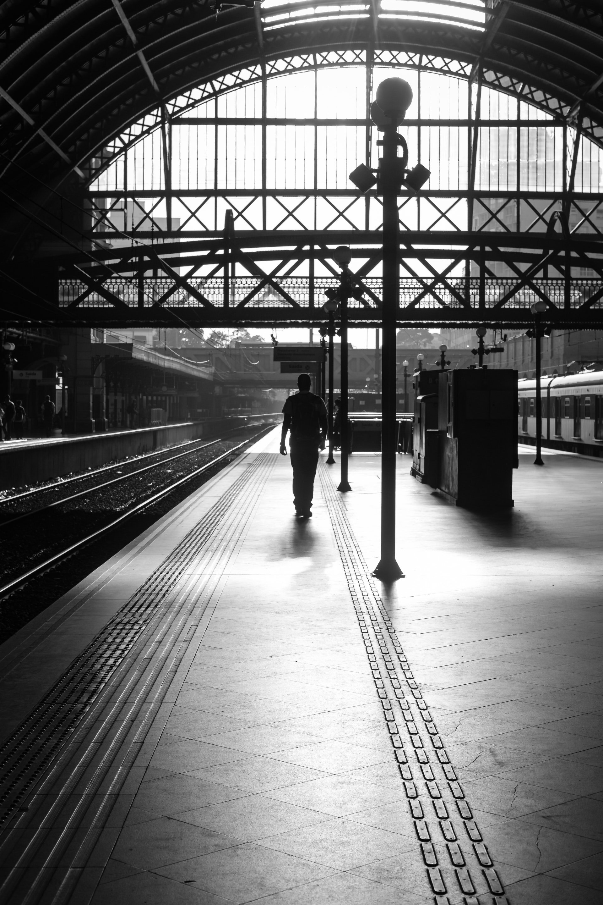
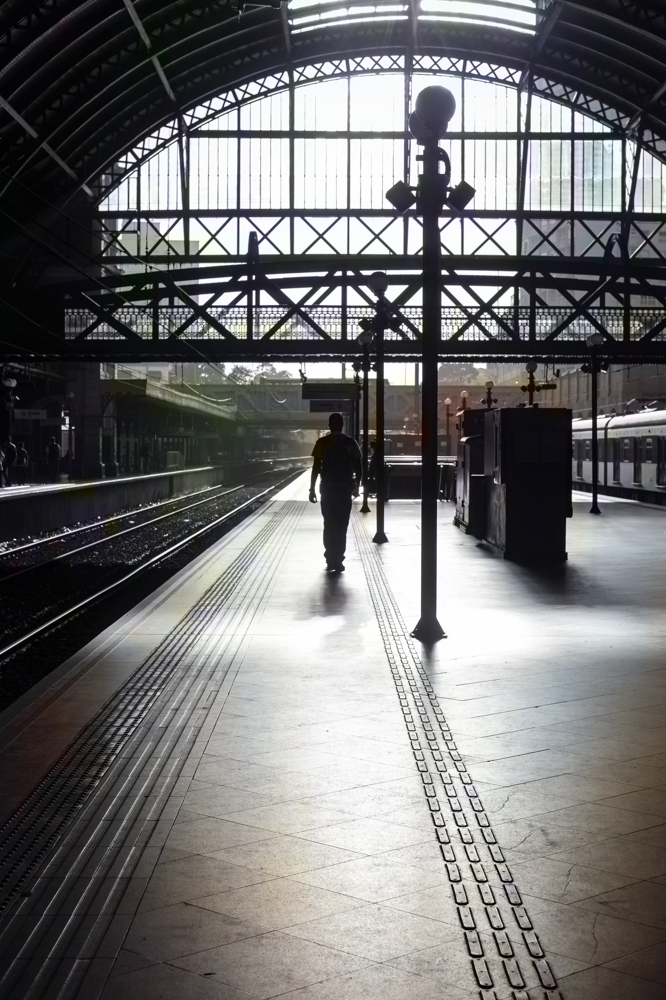

# Image Colorization

[](https://github.com/vxkram/image-colorization/actions/workflows/tests.yml)

A Flask web app that turns black-and-white photos into color using a pretrained deep learning model. Upload an image, and the app runs it through a Caffe colorization network (via OpenCV's DNN module) and shows the original next to the colorized result.




| Original | Colorized |
|---|---|
|  |  |

## How it works

The model is the [Zhang et al. colorization network](https://github.com/richzhang/colorization) (SIGGRAPH 2016): a CNN trained to predict plausible `a`/`b` color channels for a grayscale `L` channel in LAB color space. The pipeline in `colorize.py`:

1. Converts the input image to LAB and extracts the lightness (`L`) channel.
2. Feeds `L` through the network to predict the `a`/`b` color channels.
3. Recombines `L` with the predicted `a`/`b` and converts back to BGR.

The model weights aren't checked into this repo (the `.caffemodel` file is ~130 MB) — see [Setup](#setup) to fetch them.

## Features

- Upload a PNG/JPG image through a browser and get a colorized version back.
- Side-by-side before/after results page.
- Friendly error handling for bad uploads or a missing model.
- Model loaded once and cached in memory across requests, not reloaded per upload.

## Tech stack

Flask · OpenCV (`cv2.dnn`) · NumPy

## Setup

```bash
git clone https://github.com/vxkram/image-colorization.git
cd image-colorization

python -m venv .venv
source .venv/bin/activate  # .venv\Scripts\activate on Windows

pip install -r requirements.txt
python scripts/download_models.py   # fetches the ~130 MB model into models/

python app.py
```

Then open `http://localhost:5000`.

## Running tests

```bash
pip install -r requirements.txt
pytest
```

## Project structure

```
app.py                     # Flask routes: upload, colorize, result page
colorize.py                # loads the model and runs colorization
scripts/download_models.py # fetches the pretrained model files
templates/                 # upload form + result page
static/css/                # styling
models/                    # pretrained model files (gitignored, fetched via script)
uploads/                   # runtime upload/output storage (gitignored)
examples/                  # curated before/after images used in this README
tests/                     # pytest suite
```

## Limitations

- Colorization quality depends entirely on the pretrained model — it can produce desaturated or implausible colors on scenes unlike its training data.
- No persistence: uploaded images live only in the local `uploads/` folder.
